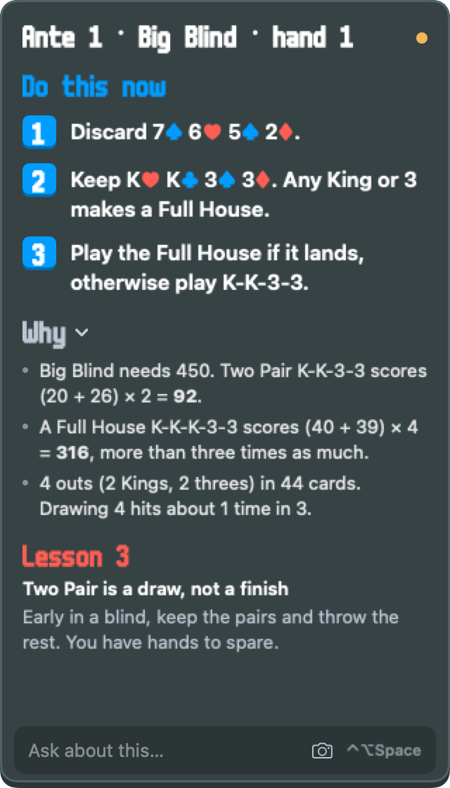

# Balabro

Balabro is a small macOS panel that sits over Balatro and coaches you through your run with Claude. Each time you draw a hand, visit the shop, open a pack or reach a blind select, it tells you what to do first and what the hand will score, then why, then a short lesson.



Balabro reads the save file the game already writes, so it needs no mods and changes nothing in the game. When you open a booster pack, it takes a screenshot of the Balatro window, because the save file doesn't include a pack's cards.

## What you need

- A Mac with macOS 14 or later.
- Balatro from Steam.
- [Claude Code](https://claude.com/claude-code), installed and logged in. Balabro runs the `claude` command with your Claude subscription, so it needs no API key. Each piece of advice is one Claude Opus turn, which counts towards your plan's usage limits.

## Install

1. Download `Balabro-<version>.zip` from the [latest release](https://github.com/EuanMorgan/balabro/releases/latest) and unzip it.
2. Move `Balabro.app` to your Applications folder.
3. Open `Balabro.app`. The app isn't notarised by Apple, so macOS blocks it the first time.
4. Open **System Settings > Privacy & Security**, scroll to the message about Balabro, and click **Open Anyway**.

To update, click **Update** when the panel says a new version is available. Balabro restarts and carries on with your run. To update from a terminal instead, run `/Applications/Balabro.app/Contents/MacOS/Balabro --update`.

## Play with it

1. Open Balabro. The panel appears, and a Balabro icon appears in the menu bar.
2. Drag the panel to a corner of the screen. It stays on top of Balatro, even in fullscreen, and remembers where you put it.
3. Start or continue a run in Balatro. Advice appears a few seconds after each decision.
4. To ask a follow-up question, such as "why keep the 6?", press **⌃⌥Space** or click the box at the bottom of the panel. The reply appears under the steps, and the steps change if the answer changes what to do. Your questions clear at the next decision. Press **Escape** to go back to the game.
5. To let the coach see the cards in a booster pack, click **Allow** on the Screen Recording line in the panel, turn Balabro on in System Settings, then reopen Balabro. Without it, the coach asks you to list the cards instead. Above the steps, the panel says whether the coach used your screen or only your save.
6. If the steps ever look wrong or out of date, click the **refresh arrow** at the top of the panel. The coach looks at the screen again and gives new steps.
7. When a run ends, the coach suggests which deck and stake to play next, based on your wins and what you have unlocked. With no run going, click **What should I play next?** to ask.
8. To chase naneinf, the score so big that it overflows the game, click the **infinity sign** at the top of the panel. It turns gold, and the coach plays for the biggest possible score and takes you into Endless Mode after a win. It stays on across runs until you click it again.
9. To watch Balabro play a run by itself, click the **play button** at the top of the panel. It opens its own copy of Balatro in a small window and plays as fast as it can. The panel shows the time, the ante, the best hand and what it's doing. A program works out each play and discard with the game's own scoring, and Claude chooses what to buy, sell and use. It uses Red Deck, or Plasma Deck if the infinity sign is on, when it keeps going into Endless Mode for naneinf. It uses only what a player could see: it never reads the draw order or uses a known seed. Your own save, stats and achievements aren't touched. Each run uses your Claude plan, as coaching does. Click **Stop** to end it.

To see how you play over time, click the Balabro icon in the menu bar and choose **Your stats**. All-time totals come from the game's own profile. Run-by-run history starts when you first play with this version.

Balatro writes its save file at most every 5 seconds, so advice can arrive a few seconds after you act. If you make two moves quickly, the coach advises on where you ended up.

### If Balabro can't find Claude

Balabro looks for `claude` the way your terminal does. To see what it found, run this:

```sh
/Applications/Balabro.app/Contents/MacOS/Balabro --locate-claude
```

If it finds nothing, check that `claude` works in a new terminal window.

## How it works

The app has two parts. `Sources/BalabroCore` is pure logic with no AppKit. It decodes `save.jkr`, decides whether a save is a decision, builds the prompt, and runs the coaching rules as one state machine (`Coach.reduce`). `Sources/Balabro` is the macOS shell. It watches the save folder, runs `claude`, takes screenshots and draws the panel. [`design/RATIONALE.md`](design/RATIONALE.md) explains the design and the choices behind it.

The game's font and its joker descriptions load at runtime from your own copy of Balatro. This repo contains no game files.

## Develop

Build and test with Swift 6.2 or later:

```sh
swift build
swift test
```

To see exactly what Claude is told about a save, run this:

```sh
swift run Balabro --print-prompt Tests/BalabroCoreTests/Fixtures/saves/02-hand.jkr
```

`tools/driver/run.sh` plays a short scripted run with your installed Balatro and keeps every save the game writes. It uses its own save folder, so your real profile isn't touched. To coach that run, point the app at the driver's save folder:

```sh
tools/driver/run.sh /tmp/balabro-saves &
swift run Balabro --saves-root "$HOME/Library/Application Support/LOVE/balabro-driver-game"
```

`tools/bot/drive.py` plays a run with your installed Balatro and a fixed plan instead of Claude, to test the "play for me" bot. Run it with `BALABRO_BOT_VERIFY=1` after a Balatro update: it checks that predicted scores match the real ones, and that changing what a player can't see doesn't change the bot's choices. To play one real run from the command line, run `dist/Balabro.app/Contents/MacOS/Balabro --play-for-me win` or `naneinf`.

To build the app and its zip for a release, run `scripts/make-app.sh <version>`. The output is in `dist/`. Run `scripts/make-signing-identity.sh` once first, so that users keep their Screen Recording permission across updates. Without it, the build is signed ad-hoc and each update loses the permission.

## Licence

MIT. Balabro isn't affiliated with LocalThunk or Playstack.
